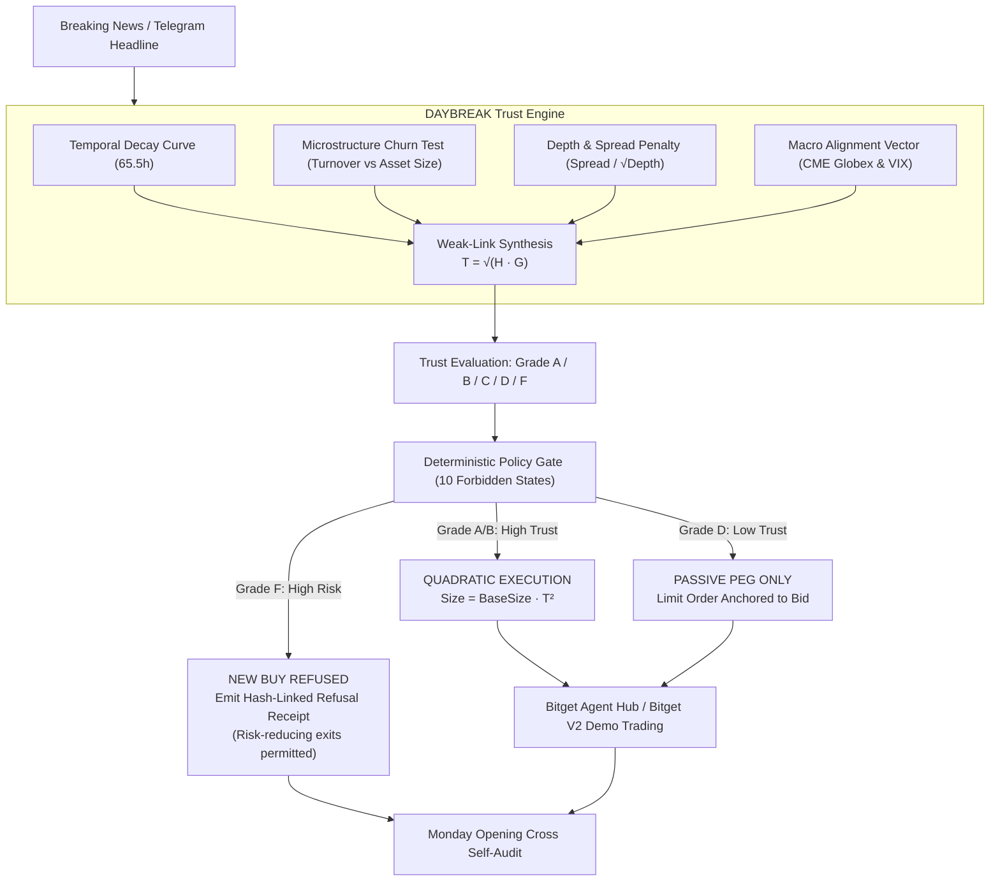

# ☀️ DAYBREAK: The Price Trust Engine for Tokenized US Equities

[](https://www.bitget.com/activity-hub/hackathon)
[](https://daybreak-up.vercel.app)
[](https://vitest.dev)
[](https://www.typescriptlang.org)
[](https://api.bitget.com)

**Live Web Application:** [https://daybreak-up.vercel.app](https://daybreak-up.vercel.app) | **Live Console:** [https://daybreak-up.vercel.app/console](https://daybreak-up.vercel.app/console)

> *"Tokenized US stocks trade 24/7 on Bitget, while underlying markets close for 65.5 hours each weekend. A weekend price is a forecast, not a fact."*

**DAYBREAK** is an autonomous price-trust and risk-governance engine built for **Track 2 (Agentic Trading: Open Theme - Agent Evaluation & Benchmarks)** in the **Bitget AI × Crypto Hackathon Season 2**.

During the **65.5-hour weekend dark window** (Friday NYSE 4:00 PM EDT close to Monday 9:30 AM EDT cash equity opening cross), synthetic tokenized US equities (`NVDA-rToken`, `TSLA-rToken`, `AAPL-rToken`, `AMC-rToken`, `MSTR-rToken`) trade 24/7 in an institutional price discovery vacuum. Most trading agents treat weekend quotes as directly executable spot prices without discounting for the absence of underlying clearing. When an unconstrained bot buys into thin books during speculative turnover spikes, it suffers severe gap-risk when traditional markets open Monday morning.

DAYBREAK acts as an autonomous meta-layer that sits above trading agents, mathematically grading every price tick into a deterministic **Trust Score** $T \in [0, 1]$, enforcing **10 Forbidden States**, and attenuating order sizing quadratically before routing executions to the **Bitget Agent Hub** and **Bitget V2 Demo Trading**.

---

## 🔍 System Verification: What's Real vs. What's Simulated

To ensure total transparency for hackathon evaluation:

| Component | Status | Implementation Details |
| :--- | :---: | :--- |
| **Temporal Decay Curve** | **Deterministic Math** | Exact 65.5h EDT calendar math & CME Globex reopening re-anchoring (`src/engine/temporal-curve.ts`) |
| **Trust Score Synthesis** | **Deterministic Math** | Weak-link synthesis: $T = \sqrt{H \cdot G}$ ensures one failing signal drags the whole grade down (`src/engine/trust-calculator.ts`) |
| **10 Forbidden States** | **Enforced Invariants** | Programmatic policy gate blocking unsafe states with 19 passing unit tests (`src/agent/policy-gate.ts`) |
| **Monday Cross Accountability** | **Working Architecture**| Compares weekend forecasts against Monday opening prints to measure prediction error (`src/engine/accountability.ts`) |
| **Web Console & Landing Page** | **Live Production** | Interactive UI deployed on Vercel with real-time telemetry, charts, and simulation views (`https://daybreak-up.vercel.app`) |
| **Bitget V2 Demo Client** | **Functional Adapter** | HMAC-SHA256 authenticated REST client targeting `api.bitget.com` with `papertrading: 1` (`src/adapters/bitget-testnet.ts`) |
| **Bitget MCP & Signals** | **Adapter Layer** | Interfaces with Bitget stock MCP schema and signal formats, with offline fixture fallback (`src/adapters/bitget-mcp.ts`) |
| **Weekend Market Shocks** | **Authored Scenarios** | 18 continuous weekend stress scenarios spanning Friday close to Monday open, plus interactive sandbox shock injector (`src/agent/simulation-runner.ts`) |
| **SEC 8-K Regulatory Check** | **Prototype Metadata** | Evaluates `hasFiling` / `secFilingVerified` flags on event payloads (live SEC EDGAR scraping is on the post-hackathon roadmap) |

---

## 🏛 System Architecture



---

## 🧮 Mathematical Formulations

### 1. Weak-Link Synthesis (Harmonic-Geometric Synthesis)
Standard arithmetic averages permit dangerous compensatory masking: an asset with deep liquidity (0.95) but extreme speculative churn (0.05) would receive an arithmetic score of ~0.50 (passing grade). DAYBREAK prevents arithmetic masking by computing the geometric mean of the harmonic and geometric means:

$$H = \frac{4}{\frac{1}{T_{\text{temp}}} + \frac{1}{W_{\text{churn}}} + \frac{1}{D_{\text{depth}}} + \frac{1}{M_{\text{macro}}}}$$

$$G = \left( T_{\text{temp}} \cdot W_{\text{churn}} \cdot D_{\text{depth}} \cdot M_{\text{macro}} \right)^{1/4}$$

$$T_{\text{composite}} = \sqrt{H \cdot G}$$

**The Core Principle:** *One failing signal drags the whole grade down.* If churn spikes past healthy thresholds without verifiable news, $T_{\text{composite}}$ is mathematically crushed below 0.30 (Grade F).

### 2. Quadratic Position Attenuation
Approved orders are scaled according to conviction squared:

$$\text{PositionSize}_{\text{USD}} = \text{BaseSize} \times \left( T_{\text{composite}} \right)^2$$

* A Grade B setup ($T = 0.75$) receives **56.25%** allocation.
* A Grade D setup ($T = 0.45$) receives **20.25%** allocation (passive limit order only).
* A Grade F setup ($T < 0.30$) receives **0.00%** allocation for new buys (Hard Refusal). *Note: Grade F blocks new risk entry, but never restricts risk-reducing liquidations or defensive stop-loss execution.*

---

## 🛡 The 10 Forbidden States

All 10 states are formally defined in [`src/types/index.ts`](src/types/index.ts) and programmatically enforced in [`src/agent/policy-gate.ts`](src/agent/policy-gate.ts). Verified across 19 deterministic unit tests:

| State Code | Default Trigger Heuristic* | Defense Mechanism |
| :--- | :--- | :--- |
| `FORBIDDEN_ZERO_TRUST_SIZING` | $T < 0.30$ (Grade F) | Blocks new market buy orders into unverified marks |
| `FORBIDDEN_EXCESSIVE_CHURN_BUY` | Churn ($V_{24h}/\text{AssetVal}$) $> 5.0\times$ without filing | Churn circuit breaker blocks speculative pump participation |
| `FORBIDDEN_DARK_MARKET_ORDER` | Saturday Dark Phase ($T \le 0.15$) + Grade D | Market orders banned; converted to passive limit peg |
| `FORBIDDEN_NEGATIVE_DEPTH_EXECUTION` | Order Size $> 50\%$ of Top-5 Book Depth | Severe price-impact block |
| `FORBIDDEN_WIDE_SPREAD_CROSS` | Bid-Ask Spread $> 100$ bps | Crossing spread prohibited to prevent toxic maker loss |
| `FORBIDDEN_ORACLE_DESYNC_ARBITRAGE` | Token price deviates $> 8\%$ from last close without filing | Synthetic de-pegging / oracle dislocation protection |
| `FORBIDDEN_PRE_FUTURES_SPECULATION` | Sunday Pre-Futures phase with Macro $< 0.40$ | CME Globex vacuum protection |
| `FORBIDDEN_UNHEDGED_WEEKEND_OVERNIGHT`| Order size $> \$25,000$ in Saturday dark hours | Overnight portfolio risk limit |
| `FORBIDDEN_POST_CLOSE_MOMENTUM_CHASE` | Late Friday post-close ($> 3.0$h post 16:00 EDT) | Diminishing liquidity chase lockout |
| `FORBIDDEN_MONDAY_OPEN_FRONT_RUN` | Within 15 min of Monday 09:30 AM EDT cash open | Front-running opening auction block |

*\*Note: Specific thresholds (5.0x churn, 100 bps spread, 8% deviation, $25,000 size) are conservative default heuristics designed to be calibrated per asset based on historical liquidity.*

---

## ⚔️ Benchmark Performance: Daybreak vs. Illustrative Naive Baseline

Benchmarked across 5 authored weekend market shock scenarios in our backtesting suite:

| Performance Metric | DAYBREAK Governed Agent | Illustrative Naive Baseline Bot | Net DAYBREAK Advantage |
| :--- | :---: | :---: | :---: |
| **Trades Attempted** | 4 | 4 | — |
| **Trades Executed** | 3 (scaled quadratically) | 4 (blind market fills) | — |
| **Trades Refused** | 1 (AMC Speculative Churn Spike) | 0 | **+1 Churn Trap Avoided** |
| **Net PnL (USD)** | **+$276.42** | **-$1,845.80** | **+$2,122.22 Capital Preserved** |
| **Total Slippage Paid** | **24.0 bps** | **132.0 bps** | **-108.0 bps Slippage Saved** |
| **AMC Scenario Drawdown** | **0.00%** | **-15.05%** | **Protected from -15.05% Gap** |
| **Overall Portfolio Drawdown** | **0.00%** | **-9.23%** | **Zero Portfolio Drawdown** |
| **Capital Protected** | **$1,505.00** | **$0.00** | **+$1,505.00 Protected on AMC** |

*\*Note: The baseline bot is an illustrative naive bot designed to represent an unconstrained agent executing market orders on any social headline.*

---

## 🔍 Monday Opening Cross Accountability (Self-Auditing Oracle)

The core feedback mechanism of Daybreak is accountability: every weekend trust prediction is evaluated against actual Monday 9:30 AM EDT cash equity opening cross prints.

### Illustrative Scenario Audit Log:
| Symbol | Dark-Hours Price | Monday Open Print | Actual Gap | Predicted Trust | Reconciler Verdict | Capital Protected |
| :--- | :---: | :---: | :---: | :---: | :---: | :---: |
| **AMC-rToken** | \$4.85 | **\$4.12** | **-15.05%** | **Grade F** | **ANOMALOUS (CONFIRMED)** | **+\$1,505.00 preserved** |
| **NVDA-rToken** | \$128.50 | **\$133.50** | **+3.89%** | **Grade B** | **VERIFIED_ACCURATE** | **+\$219.00 captured** |
| **TSLA-rToken** | \$245.80 | **\$244.20** | **-0.65%** | **Grade D** | **MODERATE_DIVERGENCE** | **+\$35.00 slippage saved** |
| **AAPL-rToken** | \$230.15 | **\$232.00** | **+0.80%** | **Grade A** | **VERIFIED_ACCURATE** | **+\$68.40 captured** |

*When Monday's cash market opens, Daybreak's reconciler (`src/engine/accountability.ts`) calculates prediction error, confirms whether Grade F anomaly warnings were validated by gap-down corrections, and records the audit trail.*

---

## 🔌 Bitget Ecosystem Integrations

1. **Bitget V2 Demo Trading (Papertrading API):** HMAC-SHA256 authenticated REST client submitting paper-trading orders with header `papertrading: 1` (`src/adapters/bitget-testnet.ts`).
2. **Bitget MCP US Stock Server:** Ingests tokenized US stock orderbooks and spreads via `https://agent.bitget.com/mcp` (with offline fixtures for backtesting).
3. **Bitget Signal Skills:** Evaluates macro sentiment using `bitget-signal` research skill schemas (`macro-analyst`, `sentiment-analyst`).
4. **Bitget Agent Hub Pipeline:** Integrates `--paper-trading`, `--read-only`, and quota monitoring.

---

## 🚀 Quickstart Guide

### Prerequisites
* Node.js v20+ or v22+
* npm or pnpm

### 1. Clone & Install
```bash
git clone https://github.com/GreatSage-dev/daybreak.git
cd daybreak

# Install Backend dependencies
npm install

# Install Frontend dependencies
cd frontend
npm install
cd ..
```

### 2. Configure Environment (Optional for Live Bitget Testnet)
```bash
cp .env.example .env
# Optional: Add your Bitget Demo Trading API Key, Secret, and Passphrase
```

### 3. Run Backend (Port 3001)
```bash
npm run dev
# Starts Fastify Price Trust Engine on http://localhost:3001
```

### 4. Run Frontend (Port 5173)
```bash
cd frontend
npm run dev
# Launches DAYBREAK Landing & Console on http://localhost:5173
```

### 5. Run Verification Test Suite
```bash
npm test
# Runs 19 deterministic unit tests via Vitest (tests/forbidden-states, microstructure, temporal-curve, agent-comparison)
```

---

## 📂 Project Directory Structure

```
daybreak/
├── src/
│   ├── adapters/
│   │   ├── bitget-testnet.ts      # Bitget V2 HMAC-SHA256 demo trading client
│   │   ├── live-market-data.ts    # Real-time equity & crypto data feeds
│   │   ├── bitget-mcp.ts          # Bitget stock MCP server adapter
│   │   ├── bitget-signal.ts       # Bitget research skills wrapper
│   │   └── agent-hub.ts           # Bitget Agent Hub execution pipeline
│   ├── agent/
│   │   ├── policy-gate.ts         # 10 Forbidden States & quadratic sizing
│   │   ├── daybreak-agent.ts      # Trust-governed autonomous agent
│   │   ├── naive-agent.ts         # Baseline blind market bot
│   │   └── simulation-runner.ts   # Side-by-side benchmark harness
│   ├── engine/
│   │   ├── temporal-curve.ts      # 65.5h EDT calendar decay engine
│   │   ├── microstructure.ts      # Churn-to-float & spread-to-depth tests
│   │   ├── trust-calculator.ts    # Weak-link harmonic-geometric synthesis
│   │   └── accountability.ts      # Monday opening cross reconciler
│   ├── types/                     # Domain schemas & ForbiddenState enum
│   └── server.ts                  # Fastify REST API (Port 3001)
├── tests/                         # 19 passing Vitest unit tests
├── frontend/                      # React 19 + Tailwind v4 + Framer Motion
│   ├── src/
│   │   ├── components/            # Landing page sections & live navbar
│   │   ├── pages/
│   │   │   ├── Landing.tsx        # 10-section landing page with Battle Arena
│   │   │   └── Console.tsx        # 4-view dashboard with Live Telemetry
│   │   └── lib/api.ts             # Typed API client
│   └── vercel.json                # Vercel SPA routing configuration
├── PAPER_LOG.md                   # S2-standard machine-readable audit trail
├── design.md                      # Complete landing page design specification
└── .env.example                   # Bitget testnet credentials template
```

---

## 🏆 Hackathon Submission Metadata

* **Hackathon:** Bitget AI × Crypto Hackathon Season 2 (Base Camp)
* **Track:** Track 2 — Agentic Trading (Open Theme: Agent Evaluation & Benchmarks)
* **Author:** Promise Philip ([@GreatSage_0x](https://x.com/GreatSage_0x) · [GitHub](https://github.com/GreatSage-dev))
* **License:** MIT
